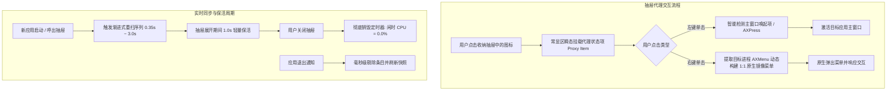

# TidyBar

> **装完即忘的 macOS 菜单栏管家：默认干净，需要时聪明。**

[](https://github.com/Oneideals/tidybar/releases)
[](https://github.com/Oneideals/tidybar)
[](https://github.com/Oneideals/tidybar)
[](https://github.com/Oneideals/tidybar)
[](#)
[](LICENSE)

**TidyBar** 是一套基于原生 Swift 与 AppKit 构建的高性能 macOS 菜单栏整理工具（对标 Bartender / Ice）。专为 macOS Tahoe 及后续系统优化，主打**极低系统占用**、**零闪烁交互**与**强鲁棒性**。

---

## 🌟 核心特性

### 1. 🍱 双形态智能收纳
* **原生推杆式原地折叠**：单击菜单栏 TidyBar 图标或使用手势，原生推杆瞬间收起/展开隐藏图标，无任何屏幕遮挡与白条闪烁。
* **极简高保真收纳抽屉**：按住 `Option` 单击图标、点击菜单栏空白区域或轻扫，即可呼出悬浮收纳抽屉（TidyBar Drawer），优雅展示所有收纳项。

### 2. 🎯 原生高清图标与代理镜像架构（Proxy Item Architecture）
* **1:1 原生 Dock 高清图标**：收纳抽屉全面采用官方高清应用图标原生渲染，彻底告别传统截图模糊与像素割裂。
* **零推杆无感代理交互**：在抽屉中点击任意图标，TidyBar 瞬间在常显区域创建原生代理状态项（Proxy Item）：
  * **左键单击**：智能探测并优先执行原生主窗口唤起（如「打开应用窗口」、「显示面板」），或精准执行原生 `AXPress` 动作；
  * **右键单击**：动态反射提取目标进程真实 `AXMenu` 节点树，构建 1:1 原生镜像菜单（全量支持二级子菜单、深浅色外观与功能项）。

### 3. ⚡️ 新启动应用多级渐进扫描（Progressive Rescan）
* **告别手动刷新**：解决 macOS 进程启动瞬间与 `NSStatusItem` 异步挂载之间的时序差（0.3s ~ 3.0s）。
* **智能自收敛序列**：收到应用启动通知后，自动排程 `0.35s`、`0.8s`、`1.5s`、`3.0s` 渐进式探测，捕获新状态项后即刻停止重试，新开应用秒级呈现在收纳抽屉中。

### 4. 🔄 抽屉展开态实时保活与退出即清
* **动态增减实时反映**：收纳抽屉处于展开状态时，后台新开启或退出的应用无缝实时更新。
* **幽灵图标杜绝**：收到应用退出通知瞬间毫秒级剔除（`removeTerminatedApp`），绝不在折叠态或抽屉内遗留幽灵占位。
* **闲时零轮询（0% CPU）**：抽屉收起后彻底销毁定时器，严格守住 **0.000% 空闲 CPU** 预算。

### 5. 🧠 跨重启身份台账（Identity Ledger）
* **多级身份降级识别**：针对第三方应用普遍缺失 `AXIdentifier` 的痛点，采用 `AXTitle / 描述` → `(归属进程 + 序号)` → `历史别名对齐` 的三级防线。
* **配置跨重启持久化**：用户调整的分区配置由台账稳定锁定，即使应用重命名或重启也不会错位。

### 6. 🖐️ 丰富的手势与空白区交互
* **智能空白区判定**：精准避开状态栏已有图标与浮现代理项，空白区域单击即呼出抽屉。
* **手势快捷触发**：支持滚轮/双指滑动切换折叠状态、自定义全局热键呼出。

---

## 🏗️ 架构与工作流

### 1. 三分区布局模型
TidyBar 将菜单栏图标划分为三个互相隔离的安全区域：
* **常显区 (Visible)**：始终驻留在菜单栏右侧，不受折叠影响（系统原生图标受系统保护强制常显）。
* **隐藏区 (Hidden)**：由 TidyBar 统一纳管，可原地折叠或在收纳抽屉中展示。
* **始终隐藏区 (Always Hidden)**：彻底隐藏的高冷图标，仅在专属操作或特定规则触发时展示。

### 2. 抽屉代理与生命周期流程



---

## 📊 性能预算与真机实测

所有指标均写入自动化测试用例守护（`PerformanceBudgetTests`），绝不妥协：

| 指标项 | 预算上限 | 真机实测 (Apple Silicon / macOS 26.6.2) | 状态 |
| :--- | :--- | :--- | :---: |
| **常驻内存 (phys_footprint)** | $\le$ 40 MB | **13.1 MB** (32+ 图标在栏，静置无增长) | 🟢 远低于预算 |
| **空闲 CPU (无键鼠输入)** | $\le$ 0.1% | **0.000%** (纯事件驱动，收起无周期任务) | 🟢 零轮询 |
| **冷启动到完整接管** | $\le$ 2.0 s | **0.52 s ~ 1.01 s** (并发枚举 + 超时熔断) | 🟢 达标 |
| **应用包体积** | $\le$ 10 MB | **2.9 MB** (精简原生架构) | 🟢 远低于预算 |
| **自动化测试覆盖** | 100% 全绿 | **352 / 352 条用例 (41 个套件)** | 🟢 全部通过 |

---

## 🚀 快速开始

### 系统要求
* macOS 14.0 (Sonoma) 或更高版本（兼容 macOS Tahoe）
* Command Line Tools 或 Xcode 15+

### 下载体验
前往 [Releases 页面](https://github.com/Oneideals/tidybar/releases) 下载最新的 `TidyBar.app.zip`，解压后拖入 `/Applications` 文件夹即可。

### 源码构建与运行

```bash
# 1. 克隆代码仓库
git clone https://github.com/Oneideals/tidybar.git
cd tidybar

# 2. 运行完整单元测试套件 (352 项)
swift run tidybar-checks

# 3. 编译并打包 Release 版本并自动部署至 /Applications
./scripts/build-app.sh release

# 4. 启动应用
open /Applications/TidyBar.app
```

---

## 🔒 隐私与系统权限

TidyBar 严格遵循 macOS 现代隐私规范：
* **辅助功能权限 (Accessibility)**：必选。用于读取菜单栏状态项几何坐标、枚举图标树并转发点击事件。
* **屏幕录制权限 (Screen Recording)**：可选。用于截取第三方菜单栏像素，若未授予，TidyBar 将完全依靠官方应用图标与原生材质呈现。
* **100% 离线与隐私保护**：**零网络连接，零数据收集，零第三方依赖库**。所有台账与配置仅保存在本地 `~/Library/Application Support/TidyBar/`。

---

## 📂 项目结构

```
tidybar/
├── Sources/
│   ├── TidyBar/              # NSApplication 入口层
│   ├── TidyBarCore/          # 核心业务引擎
│   │   ├── Model/            # ManagedItem、MenuBarLayout、分区模型
│   │   ├── Accessibility/    # AX 接口、窗口列表截取、输入模拟
│   │   ├── Layout/           # 意图台账、布局对齐、恢复机制
│   │   ├── Panel/            # 收纳抽屉、几何计算、图标呈现
│   │   ├── Events/           # 事件引擎、全局快捷键、手势识别
│   │   ├── Safety/           # 崩溃防御、拖拽哨兵
│   │   └── App/              # TidyBarApplication、控制器、PeekCoordinator
│   └── TidyBarChecks/        # 零依赖自动化单元测试框架 (352 Tests)
├── scripts/                  # 构建、打包、签名与性能测试脚本
└── docs/                     # 架构设计、演进日志与实机分析
```

---

## 📄 开源许可证

本项目采用 [MIT 许可证](LICENSE) 开源。欢迎提交 Issue 或 Pull Request！
